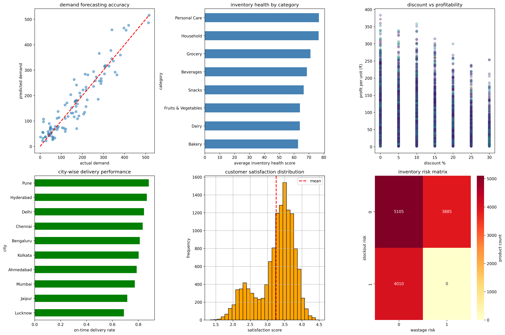

# Blinkit Operations Analytics - Data Doyen Case Study Competition

## Problem Statement

Blinkit faces critical operational challenges across its hyperlocal delivery network. The goal
was to design a data-driven analytics strategy to simultaneously improve inventory efficiency,
delivery performance, discount optimization, and customer satisfaction — using only the
provided `blinkit_dataset.csv`.

---

## Approach

An eight-step integrated analytics pipeline was built end-to-end, by developing models specific to the faced problem:

1. **Data Preprocessing** - Parsed dates, handled boolean conversions, audited missing values
2. **Feature Engineering** - Derived 20+ columns: `stockout_risk`, `wastage_risk`, `remaining_shelf_life_pct`, `inventory_turnover`, `discount_effectiveness`, `satisfaction_score`, and more
3. **Demand Forecasting** - Random Forest Regressor trained on 24 features (pricing, shelf-life, city, category, brand) to predict SKU-level `sold_quantity`
4. **Inventory Optimization** - Computed optimal stock levels, flagged urgent reorders, predicted wastage for near-expiry perishables, and scored each SKU with a composite inventory health score (0-100)
5. **Discount Optimization** - Rule-based engine: 0% for stockout-risk SKUs, 30% for wastage-risk items, up to 10% for fast movers, 15% for slow movers
6. **Delivery Prediction** - Gradient Boosting Classifier to predict on-time delivery probability; priority-flagged perishable high-rated delay-prone orders
7. **Customer Satisfaction and Churn** - K-Means clustering (k=4) producing four segments; composite satisfaction score weighted across rating, delivery time, and on-time rate; churn risk score per SKU
8. **Action Dashboard** - Combined all signals into a single `action_priority_score`, surfacing the top 20 SKUs for immediate operations team action

---

## Tech Stack

Python3, pandas, NumPy, scikit-learn (RandomForestRegressor, GradientBoostingClassifier, KMeans), Matplotlib, Seaborn.

---

## Evaluation Metrics

| Model | Metric | Value |
|---|---|---|
| Demand Forecasting (Random Forest) | MAE | 35.51 units |
| Demand Forecasting (Random Forest) | RMSE | 46.20 units |
| Demand Forecasting (Random Forest) | R2 Score | 88.09 % |
| Delivery Prediction (Gradient Boosting) | Accuracy | 79.12 % |

---

## Key Insights

- Over 4,000 SKUs at stockout risk and ~3,885 at simultaneous wastage risk, revealing misaligned replenishment cycles
- Bakery and Dairy score lowest on inventory health due to short shelf lives and demand volatility
- Pune and Hyderabad lead on-time delivery; Lucknow and Jaipur fall below the 75% threshold and require routing intervention
- Satisfaction score peaks around 3.3-3.5/5.0; churn risk is concentrated in SKUs with ratings below 3.5 and poor delivery performance
- Discount rebalancing (protecting margin on fast movers, clearing wastage items aggressively) projects a net positive revenue impact

---

## Analytics Dashboard

Below is the analytics dashboard generated from the processed dataset, containing six plots:
demand forecasting accuracy, inventory health by category, discount vs. profitability, city-wise
delivery rates, customer satisfaction distribution, and an inventory risk matrix.

---

## Further Improvements

- Replace Random Forest with LSTM for time-series demand forecasting to capture seasonality and festive spikes
- Integrate stockout/wastage model with a real-time streaming pipeline for live dark-store reorder alerts
- Move discount logic from rule-based to a reinforcement learning model for continuous margin-aware optimization
- Apply NLP sentiment analysis on review text to surface dissatisfaction signals beyond numeric ratings
- Build a city-level readiness index combining inventory health, delivery performance, and churn risk to prioritize rollout

---

## License

See [LICENSE](LICENSE.txt) 